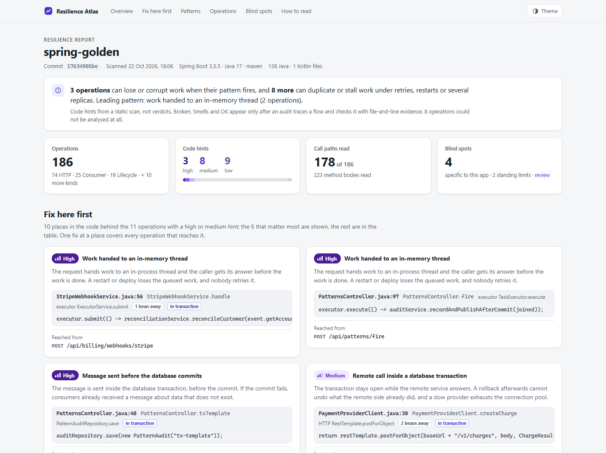

# resilience-audit

A Claude Code plugin for auditing large Spring Boot applications for reliability and
high-availability failure modes: lost acknowledged work, dual writes, unsafe retries,
non-durable async hand-offs, scheduler races, unbounded dependency calls, unsafe rollouts.

Asking Claude to "find HA problems" across a monolith burns context on rediscovering the
architecture and gives different coverage on every run. This plugin instead:

1. builds a persistent, machine-readable **atlas** of the application with deterministic
   scripts — entry points, transactions, side effects, async boundaries, messaging,
   schedulers, external clients;
2. maps the atlas onto business domains and ranks critical flows;
3. runs small, narrow audit skills that query the atlas and open only the code needed to
   prove or disprove one reliability hypothesis for one flow.



> **Status: early.** The entry-point atlas, the effect analysis, the HTML report and the quick
> check work: scanner, query CLI, the report, four phase-1 skills and the `audit` skill, which
> checks every high and medium hint with a cheap model. The deep audit that verifies findings
> is not built yet.

## Install

You need Claude Code and a JDK 17 or newer on `PATH`. The scanner parses Java with the JDK's
own compiler, so a JRE is not enough.

In a Claude Code session:

```text
/plugin install resilience-audit --marketplace kiryl-volkau/spring-resilience-atlas
```

Or from a shell:

```bash
claude plugin marketplace add kiryl-volkau/spring-resilience-atlas
claude plugin install resilience-audit@resilience-atlas
```

Then open a Spring repository in Claude Code and run `/resilience-audit:report`. The skills
need a local shell and a JDK, so they work in Claude Code, not in claude.ai chat.

### What the plugin runs

- **The scanner, from source.** Skills run `java <plugin>/scanner/Launch.java`. On first use
  it compiles the bundled scanner sources with the JDK's compiler into the plugin's data
  directory (`~/.resilience-atlas` when that is unavailable) and reuses the build until the
  plugin changes. The plugin ships no compiled code.
- **Local files only.** The scanner reads the source files of the repository you opened and
  writes only `.reliability/` inside it. `report --open` opens the generated page in your
  browser.
- **No network.** Nothing is downloaded or sent anywhere, and there is no telemetry. Claude
  reads the scanner's output, and audit skills open the files needed for one hypothesis, as
  in any Claude Code session.

## How it works

```text
Spring repository
      │
      ▼
deterministic scan (scripts, no LLM) ──► .reliability/atlas/
      │
      ▼
domain map ──► critical-flow ranking ──► trace one flow
      │
      ▼
narrow audit skills (durability, messaging, idempotency, ...)
      │
      ▼
evidence-backed findings ──► verifier / deduper ──► backlog + coverage ledger
```

Two kinds of work are kept apart:

- **Mechanical discovery** — every `@RestController`, `@KafkaListener`, `@SqsListener`,
  `@Scheduled`, `@Async`, `@Transactional`, `RestTemplate`, `WebClient`, `JpaRepository`,
  Flyway migration — is found by scripts and stored in the atlas.
- **Reasoning** — whether a particular combination of those can lose, duplicate or corrupt
  business work — is done by Claude, one flow and one question at a time.

The unit of analysis is a **business flow**, not a class or a controller:

```text
external trigger → entry point → transaction → state mutation → durable/async boundary
  → downstream processing → external effects → observable outcome → recovery mechanism
```

## The atlas

Written into the audited repository under `.reliability/atlas/`:

| File | Contents | State |
|---|---|---|
| `manifest.json` | commit, build tool and modules, Spring Boot and Java versions, file counts, warnings | built |
| `entrypoints.jsonl` | HTTP (with functional routes and a webhook tag), messaging (annotated and programmatic: Kafka, SQS, Rabbit, JMS, Stream, Pub/Sub, Kinesis, Camel), scheduled (annotated and programmatic), events, startup/shutdown hooks, SOAP, Quartz/Batch jobs, WebSocket, GraphQL, gRPC, Actuator operations, Spring Portlet MVC handlers | built |
| `types.jsonl` | every type with supertypes, stereotypes and annotations, for interface → implementation lookups | built |
| `domains.jsonl` | business domains as package prefixes, with confidence; written by `domain-cartographer`, corrected by people | built |
| `effects.jsonl` | per entry point, the effects on its call path (entry method, its class, up to three injected beans) with file:line: async hand-offs, in-memory state, local files, DB writes, message sends, remote calls, events, transactions, retries, locks, idempotency checks | built |
| `transactions.jsonl` | `@Transactional` boundaries and their attributes | planned |
| `persistence.jsonl` | repositories, entity writes, `JdbcTemplate` usage | planned |
| `message-producers.jsonl` | SQS / Kafka / Rabbit sends | planned |
| `async-execution.jsonl` | `@Async`, executors, `CompletableFuture`, application events | planned |
| `external-clients.jsonl` | `RestTemplate`, `WebClient`, Feign and SDK clients with timeout / retry config | planned |
| `migrations.jsonl` | Flyway / Liquibase changes | planned |

What produces each entry-point record, and how each field is computed, is defined in
[`plugin/schemas/entrypoint-rules.md`](plugin/schemas/entrypoint-rules.md). Every record carries:

- the file, line, class, method and triggering annotation;
- the build module;
- a discovery status: `STATIC`, `INFERRED` or `UNKNOWN`;
- `via` tags that say how the record was derived.

Unresolvable values stay visible as `<expression>` instead of being guessed. The manifest
pins the commit, and every query says whether the atlas is behind `HEAD`.

What the scan cannot see is named rather than silently missing. The manifest warns about:

- entry-like annotations from libraries outside the source set; on one portal codebase this
  surfaced 190 Spring Portlet handlers;
- controllers that extend library classes;
- Kotlin, Groovy, parse failures and missing generated interfaces;
- `@Scheduled` without `@EnableScheduling`.

`doc not-in-atlas.md` lists the rest.

Measured on real repositories:

| Repository | Result |
|---|---|
| thingsboard, 5.5k files | 922 / 922 HTTP endpoints match a hand-checked baseline; programmatic Kafka and SQS consumers were found |
| nacos | 433 / 433 constant-built paths match |
| Scan time | 0.3–3 s per repository |

## The report

`/resilience-audit:report` runs one scanner command, `report --scan --open`. It writes
`.reliability/report.html`, a single self-contained page with no network access:

- a one-sentence headline;
- **Fix here first**: the places in the code behind the operations with a high or medium code
  hint, grouped so that one fix covers every operation reaching it;
- the risk patterns and areas;
- every operation with its evidence;
- the blind spots: what a source scan could not see in this application.

A **code hint** (High, Medium, Low, No pattern, Not analysed) comes from rules in
`plugin/scanner/.../report/Risk.java` applied to the effects. Examples are work handed to an in-memory
thread after the caller was answered, a message sent before the commit, or a job without a lock.
A hint says where to look first; it is not a verdict.

**Statuses** (Broken, Smells, OK, Not audited) are a separate vocabulary. They come only from
audit verdicts and findings in `.reliability/audit/`, and the generator computes every colour
from those records. The skill costs about $0.01 on Haiku.

## The quick check

`/resilience-audit:audit` turns hints into verdicts without one agent per operation. The work
is a funnel:

1. **Hints, no model.** The scan and `Risk.java` flag operations, as above.
2. **Places, no model.** Operations that share the code a fix would change are grouped into one
   place: a rule code at the method enclosing its evidence. A large application has far fewer
   places than operations.
3. **Quick check, cheap model.** The scanner writes an evidence packet per batch of up to eight
   places: the rule's hypothesis, its named mitigations, the effects it cited and the methods
   around them. A `place-checker` agent (Haiku by default) answers CONFIRMED, REFUTED, MITIGATED
   or UNCERTAIN per place, with evidence that the scanner verifies line by line before it stores
   the verdict.
4. **Deep audit, strong model** (next): the confirmed high places and the ones a user picks,
   traced in full and checked by a verifier that tries to disprove each finding.

The first call only plans: it prints the places, the estimated tokens and dollars, the cap and
the command that runs exactly that plan, and spends nothing. A run counts each batch as spent
when it starts, stops at the cap, and never checks a place again until its code changes. The
report then shows quick-check verdicts on its places, operations as Smells ("suspected") or
Checked (quick), and `.reliability/backlog.md` lists one task per confirmed place with its
evidence, the mitigations checked, a fix and a way to verify it.

Inventories and hints were checked by hand against the local corpus (`evals/corpus.md`). Those
results stay outside this repository, like the corpus itself; the golden fixture pins the rules
they led to.

## Findings

Every finding is an evidence packet, not an opinion: rule id, domain, flow, a concrete
failure scenario, file/symbol evidence, existing mitigations, blast radius, recommendation,
and a verification procedure. **Severity** (how bad if true) and **confidence** (how sure
it is real) are separate fields. Candidate findings are high-recall; a separate verifier
tries to disprove each one before it reaches the backlog.

"No findings" is never reported as "safe" — the coverage ledger records which flows and
which audit profiles actually ran against which commit.

## Roadmap

| Phase                | Skills                                                                                                                                                                                    |
|----------------------|-------------------------------------------------------------------------------------------------------------------------------------------------------------------------------------------|
| 1. Atlas (MVP)       | built: `atlas-bootstrap`, `entrypoint-catalog`, `domain-cartographer`, `critical-flow-tracer` (agent `flow-tracer`), `report`, `audit` (quick check, agent `place-checker`). Next: the deep audit and its verifier, `critical-flow-discovery` |
| 2. Reliability       | `durable-handoff-audit`, `transaction-dual-write-audit`, `messaging-reliability-audit`, `idempotency-retry-audit`, `async-execution-audit`, `external-dependency-resilience-audit`, `shutdown-deployment-audit` |
| 3. Observability     | `observability-coverage-map`, `trace-continuity-audit`, `sli-alert-audit`, `logging-diagnostics-audit`, `production-evidence-correlator`, `recovery-reconciliation-audit`                |
| 4. Verification      | `finding-verifier-deduper`, `failure-injection-test-designer`, `backlog-task-generator`, `coverage-ledger`                                                                               |

Phase 1 is done when these questions are answered from the atlas, without Claude rereading
the application:

- Show all Billing entry points.
- Show all queue consumers in Resident.
- Show scheduled jobs that mutate database state.
- Show flows that both write to the database and publish a message.
- Show external clients reachable from Daily Care.

## Layout

Only `plugin/` is installed. Everything else in the repository is for developing it.

```text
plugin/                             the plugin users install
  .claude-plugin/plugin.json        plugin manifest
  skills/<skill>/SKILL.md           atlas-bootstrap, entrypoint-catalog, domain-cartographer, critical-flow-tracer, report, audit
  agents/flow-tracer.md             forked agent behind critical-flow-tracer
  agents/place-checker.md           the quick check's judge, one batch of places per agent
  scanner/                          atlas builder and query CLI: dependency-free Java, run from source by Launch.java
  schemas/                          entry-point rules, and entrypoint/domain/flow/finding JSON schemas
  references/                       the query CLI's commands and what the atlas cannot see
  evals/                            claude plugin eval cases
  assets/                           icon and screenshot
.claude-plugin/marketplace.json     lists plugin/ for installation
pom.xml                             development build of the scanner jar
fixtures/spring-golden/             synthetic Spring app with hand-written expected results
evals/                              golden test and cost measurement
```

## Decisions

These were settled by a parser and corpus spike on 2026-10-22:

- **Scanner.** Java on the JDK's own javac Tree API, with no dependencies. The plugin ships
  its sources, and `plugin/scanner/Launch.java` compiles them on first use, so a directory listing
  carries no binaries and nobody needs Maven. It needs a JDK 17+ on `PATH`. Unlike
  JavaParser, javac never lags the target's Java version.
- **Storage.** JSONL that skills never load whole. The CLI prints a summary line, then TSV
  projections, 50 rows by default.
- **Models.** Haiku for the mechanical catalog skills and the quick check, Sonnet for domain mapping, Opus for
  flow tracing. Fable 5.1 is reserved for the audit reasoning that comes next.

Still open:

- **Atlas location.** Commit `.reliability/` in the audited repository, or keep it local and
  rebuild it.

## Development

```bash
java plugin/scanner/Launch.java version                                # runs the scanner from source, as the skills do
mvn -o -q package                                                      # builds dist/resilience-atlas.jar
java -cp dist/resilience-atlas.jar evals/GoldenTest.java fixtures/spring-golden   # golden test
```

The build pins plugin versions that resolve from the local Maven cache (`-o`). Drop `-o` when
a Maven repository is reachable.

Run Claude Code inside a Spring repository with this plugin loaded from disk:

```bash
claude --plugin-dir /path/to/spring-resilience-atlas/plugin
```

Skills are invoked as `/resilience-audit:<skill>`, and `/reload-plugins` picks up edits
without restarting the session. Plugin evals are described in
[`evals/README.md`](evals/README.md). The local evaluation corpus is listed in
`evals/corpus.md`, which stays out of git.

## License

Copyright 2026 Kiryl Volkau. Licensed under the [Apache License, Version 2.0](LICENSE).
